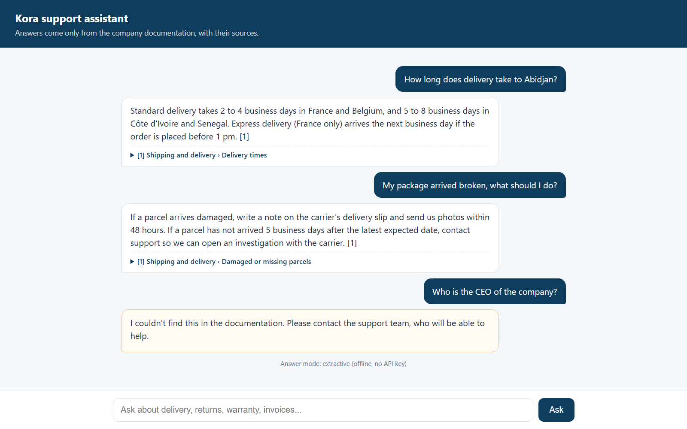

# Support chatbot that answers only from your documents (RAG)

A customer-support assistant for a fictional office-supplies company. Ask a question in plain English; the assistant finds the right section of the documentation, answers from it, and **shows the source**. When the documentation doesn't cover the question, it **says so instead of inventing an answer**.



## How it works

```
docs_kb/*.md ──► chunks (one per "##" section) ──► BM25 index
                                                     │
question ──► customer-words glossary ──► search ─────┘
                                           │
                       best score too low? ──► "I couldn't find this in the documentation"
                                           │
                               top 3 sections ──► answer + numbered sources
                                                   ├─ extractive mode: best sentences, offline, free
                                                   └─ LLM mode: OpenAI model writes the answer from these sections only
```

- **Retrieval**: BM25 (the ranking used by Elasticsearch / Lucene) over sections of Markdown documents, with a small glossary that maps customer wording to documentation wording (*package → parcel*, *broken → damaged*). No external service needed.
- **Grounded answers**: the LLM prompt only contains the retrieved sections, asks for citations like `[1]`, and has an exact refusal sentence.
- **Two answer modes**:
  - *extractive* (default): returns the most relevant sentences as-is — works offline, costs nothing, used in the tests;
  - *LLM* (opt-in with `ASSISTANT_MODE=llm` + `OPENAI_API_KEY`): an OpenAI chat model writes a short answer from the sections. If the API fails, the assistant falls back to the extractive answer instead of crashing. An API key present in the environment is **not** enough to switch it on, so it never calls a paid API by surprise.
- **Web chat + JSON API** with FastAPI, plus a terminal mode.

## Measured retrieval quality

[`eval/questions.json`](eval/questions.json) holds 34 questions written in customer words, different from the documentation's wording: 29 the docs answer, 5 they don't.

```bash
python eval/evaluate.py
```

| Metric | Result |
|---|---|
| Right section ranked first (hit@1) | 86% (25 / 29) |
| Right section in the top 3 (hit@3) | 90% (26 / 29) |
| Answerable questions wrongly refused | 3 / 29 |
| Out-of-scope questions correctly refused | 5 / 5 |

The misses are listed by the script (e.g. *"Can you ship to Germany?"*: the docs list the countries served, but never the word "Germany"). This is the known limit of keyword search; for a larger or messier knowledge base, the next step is hybrid search (BM25 + embeddings in pgvector or Chroma), measured on the same question set.

## Run it

```bash
python -m venv .venv
.venv/Scripts/activate        # Windows  (source .venv/bin/activate on macOS / Linux)
pip install -r requirements.txt

# Web chat on http://127.0.0.1:8000
uvicorn docs_assistant.app:app --app-dir src --port 8000

# Terminal
PYTHONPATH=src python -m docs_assistant "Is shipping free?"

# LLM mode (optional)
ASSISTANT_MODE=llm OPENAI_API_KEY=... uvicorn docs_assistant.app:app --app-dir src
```

API:

```bash
curl -X POST http://127.0.0.1:8000/api/ask -H "Content-Type: application/json" \
     -d '{"question": "When is an invoice due?"}'
# {"answer": "...30 days after the delivery date... [1]", "answered": true, "mode": "extractive",
#  "sources": [{"title": "Payment and invoices", "section": "Paying by invoice", ...}]}
```

## Tests

```bash
pytest -q     # 15 tests
```

They cover chunking, stemming, answers with their sources, refusals, the API, a retrieval-quality floor (hit@3 ≥ 85%, 5/5 refusals), and the LLM mode with a fake OpenAI client (no network): prompt content, citations kept, refusals, fallback when the API fails, and the opt-in rule.

## Using it with your documents

1. Put your FAQ, policies or product sheets in `docs_kb/` as Markdown (one `##` heading per topic). PDFs and Word files can be converted first.
2. Add your customers' usual words to `SYNONYMS` in `retrieve.py`.
3. Write 20–30 real customer questions in `eval/questions.json` and run the evaluation before and after each change.
4. Connect the `/api/ask` endpoint to your website widget, WhatsApp or Slack bot.

## Stack

Python 3.10+, FastAPI, OpenAI Python SDK (optional), pytest. All documents and the company are fictional.

## License

MIT
